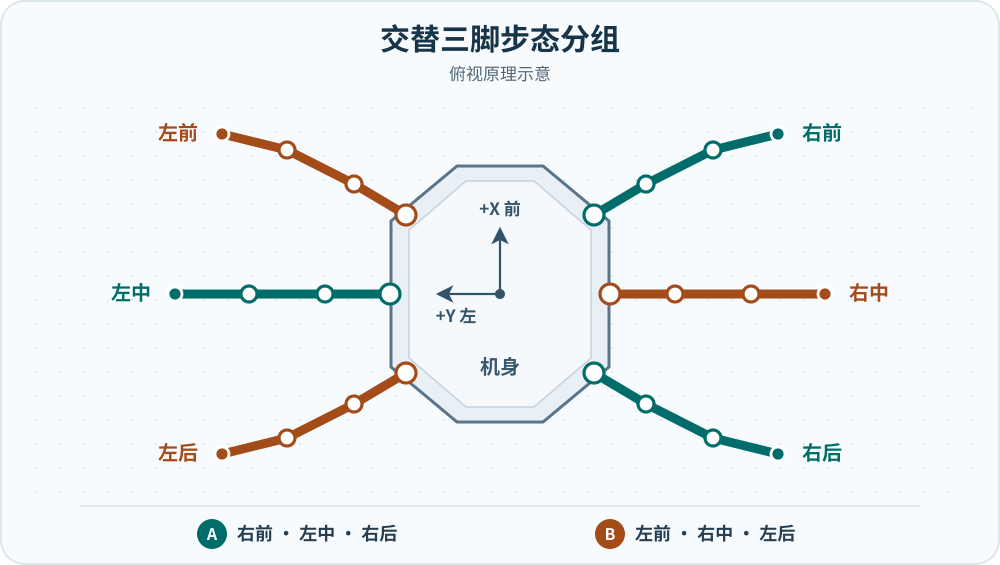

# Hexapod V1

基于树莓派 4B、ROS 2 Jazzy 和 C++17 的六足机器人。Lm2 金属机架搭载 18 只幻尔 LX-225 总线舵机，树莓派通过串口控制板执行六腿运动学规划生成的目标。V1 在无 IMU 的条件下运行交替三脚步态。

> **本地调试工具**  项目开发时使用的 Windows 控制台和树莓派 Python 桥接器位于 `hexapod_remote/`，仅用于本地联调，源码留在本机。V1 的三个 ROS 2 核心节点可独立运行。你可以按自己的需求实现外层控制程序，通过 `command_request` 或 `joy` 话题接入 `hexapod_command`。 [控制节点接口](hexapod_ws/src/hexapod_control/README.md#命令接收节点)



## V1 实机验收

2026 年 11 月 26 日，我在实机上完成前进、后退、横移、原地转向及停止收脚的调试，确认这些动作均正常。V1 也支持从当前姿态过渡到初始站姿、按指定周期数行走，以及用手柄输入组合平移和偏航。站姿验收会回读 18 轴位置，行走中由规划器检查关节限位和足端路径，并在完整周期边界安排减速与收脚。离线回归使用正式节点与虚拟串口。详见[开发和验收记录](hexapod_ws/docs/core-deployment-validation.md)。

### 默认运动参数

| 参数 | 默认值 |
| --- | ---: |
| 行走周期 | 4.0 s，20 段 × 200 ms |
| 支撑占空比 | 0.55 |
| 摆动脚抬升 / 外摆 | 40 mm / 25 mm |
| 手柄纯前进 / 纯后退 | 0.035 m/s，每个峰值周期名义位移 140 mm |
| 手柄纯横移 | 0.020 m/s |
| 手柄纯偏航 | 0.20 rad/s |

手柄输入是归一化杆量，组合方向共享速度额度。指定周期路线直接使用物理速度和完整周期数。表中数值为配置与名义规划值，实机验收记录的是动作表现。

## 软件结构

运行链路由 `hexapod_command`、`hexapod_planner` 和 `hexapod_serial` 三个 ROS 2 节点组成。规划器把运动指令转换为 18 轴分段目标，串口节点回报站姿就绪和执行状态。

| 软件包 | 职责 |
| --- | --- |
| [`hexapod_core`](hexapod_ws/src/hexapod_core/) | 机器人几何、正逆运动学、交替三脚步态、关节与足端路径约束。可独立构建。 |
| [`hexapod_control`](hexapod_ws/src/hexapod_control/) | 命令接收、手柄速度映射、周期规划、停止和收脚。 |
| [`hexapod_hardware`](hexapod_ws/src/hexapod_hardware/) | 控制板协议、串口调度、站姿回读和执行回报。 |
| [`hexapod_interfaces`](hexapod_ws/src/hexapod_interfaces/) | ROS 2 命令、计划和状态消息。 |
| [`hexapod_bringup`](hexapod_ws/src/hexapod_bringup/) | 三节点虚拟串口集成测试。 |

## 构建与测试

在 Windows 上可以用 CMake、支持 C++17 的工具链和 Python 3 独立验证核心库。下面是 MinGW 的 PowerShell 示例，从仓库根目录运行。

```powershell
cmake -S hexapod_ws/src/hexapod_core -B hexapod_ws/build/core -G 'MinGW Makefiles' -DBUILD_TESTING=ON "-Dnlohmann_json_DIR=$PWD/hexapod_ws/dependencies/json-3.11.3/cmake"
cmake --build hexapod_ws/build/core --parallel 1
ctest --test-dir hexapod_ws/build/core --output-on-failure
```

完整 V1 使用 WSL 交叉编译 ARM64，在树莓派上生成 Jazzy 接口、单任务链接并安装。Windows 本地编辑入口为 `hexapod.code-workspace`。具体路径和构建约束见[双端工作流](hexapod_ws/docs/windows-vscode-workflow.md)。

## 项目文档

- [V1 架构](hexapod_ws/docs/v1-architecture.md)记录步态设计、消息接口及后续 IMU 和误差调节的扩展约定。
- [物理基准](hexapod_ws/docs/physical-baseline.md)与[硬件配置](hexapod_ws/config/robot_hardware.json)记录舵机映射、零位、限位和 CAD 几何参数。 [舵机编号示意图](docs/v1-servo-numbering.svg) · [单腿几何与站姿示意图](docs/v1-leg-geometry.svg)
- [仓库文件说明](docs/github-repository.md)列出源码、资料及本机文件的分发范围。
- [旧固定帧 Demo](ros2_ws/src/hexapod_demo/README.md)保留早期站立与步态实验。
