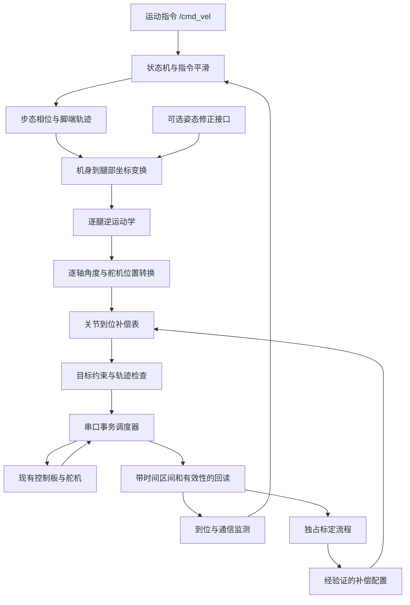

# v1 软件架构：运动学步态与关节到位误差补偿

日期：2026-10-17。状态：实施方案；已完成 [基础类型、配置模型与关节转换](../hexapod_ws/src/hexapod_core/README.md)，源码保留于 Windows `hexapod_ws/src/hexapod_core` 和树莓派 `/home/hexapod/hexapod_ws/src/hexapod_core`，参见 [Windows 编辑与同步说明](windows-vscode-workflow.md)。其余模块待实现，尚未实机验证。

## 1. 目标与范围

使用现有树莓派 4B、幻尔总线舵机控制板和 18 只 LX-225，通过 ROS 2 Jazzy / C++17 实现：

- 由运动学生成站立和步态目标，支持前后移动、横移、原地转向、平滑启停与指定完整周期数行走。
- 减小目标关节角与稳定后实际到达角之间的可重复误差，提供到位检查与标定工具。
- 无 IMU 时独立运行；预留 IMU 数据与姿态修正接口。

本版不实现地形适应、脚端受力/形变补偿、自动纠正走偏、定位导航、动力学控制或在线自适应学习。基础几何、关节转换和安装限位仍是运动学执行的必要输入，不属于新增的物理误差补偿工程。

“实际角度”默认指舵机位置回读经逐轴转换后的角度，必须在报告中写明观测来源。若回读正确而机械角度不正确，需要外部角度测量，回读闭环无法自行发现。v1 支持录入外部标定数据，不强制增加传感器。

## 2. 硬件约束与参数来源

- 物理事实继续以 [physical-baseline.md](physical-baseline.md) 和 [robot_hardware.json](../config/robot_hardware.json) 为准。本方案不修改或补造物理参数。
- 保留既有 ID：右前 1–3、右中 4–6、右后 7–9、左前 10–12、左中 13–15、左后 16–18。
- 500 是用户确认的展开参考值；逐轴数学参考角、方向符号和安装限位需要分别记录，不能由镜像批量推断。
- 固定机身安装变换、第一段 L2、第二段 2×L1+d、第三段 L3 分开建模。CAD 值保留来源与待验证状态，胶垫触地点不自动等同于金属脚端。
- 未知关键参数保留 null。预览可使用显式候选模型；实机动作需要对应关节和动作范围的有效参数。启用某动作前验证其整个轨迹，不要求为了单腿测试先完成所有全身标定。
- 当前控制板原厂 UART 固定为 9600、8N1。官方 FAQ 第 8 项明确说明不可修改；不能通过更改树莓派波特率提速。[官方 FAQ](https://forum.hiwonder.com.cn/t/topic/440)
- 控制板协议与直连舵机协议不同。未来升级通信只替换硬件后端，不把当前协议包按新速率直接复用。[控制板协议](https://docs.hiwonder.com/projects/Bus-Servo-Controller/en/latest/docs/2.Bus_Servo_Controller_Secondary_Development.html)
- 新 v1 电压策略依据现有 LX-225 规格书 6–8.4V；旧 demo 的 8.7V 临时例外只属于原 demo，不自动继承。电压采样的精度仍未标定。

## 3. 运行结构

采用一个主要 ROS 节点、一个纯算法库和一个串口工作线程。主节点内用类划分职责，避免将每一层拆成独立节点。



主循环不等待串口回包。所有串口操作由一个工作线程串行执行，使用期限明确的事务；不允许标定程序、ROS 回调和诊断工具同时操作同一设备。

## 4. 包与模块

下面是模块规划；工作区在 Windows 为项目内的 `hexapod_ws`，在树莓派为 `/home/hexapod/hexapod_ws`。`src/hexapod_core` 已实现，其余新包为空目录、待实现。下方 `ros2_ws` 仅表示工作区层级。Windows 配置本地编辑器解析，目标平台构建仍在树莓派执行。

```text
ros2_ws/src/
  hexapod_core/                  # 不依赖 ROS 或串口的 C++ 库
    model                       # 几何、逐轴映射、参数来源与有效性
    kinematics                  # FK / IK、解支连续性、可达性
    gait                        # 相位、支撑/摆动、轨迹与启停
    joint_compensation          # 到位补偿模型与误差评估
    constraints                 # 安装限位、每段速度、补偿幅度
    types                       # 指令、轨迹段、反馈与状态
  hexapod_hardware/              # 协议、传输、事务调度与假设备后端
  hexapod_control/               # 主节点、状态机、标定会话、ROS 接口
  hexapod_bringup/               # 启动文件与运行/步态配置
  hexapod_demo/                  # 保留现有固定帧参考与协议测试
```

核心内部使用米、弧度、秒；现有硬件 JSON 的毫米/度在加载边界显式转换。舵机位置单位只在映射、补偿和硬件边界使用。腿索引、关节索引与物理 ID 采用明确映射，不依赖容器遍历顺序。

自定义代码统一使用下划线命名。主要类为 robot_model、leg_kinematics、gait_planner、joint_mapper、joint_compensator、constraint_checker、bus_scheduler、arrival_monitor、calibration_session、motion_state_machine；类接口和实现分别放在对应的 .hpp 和 .cpp 中。避免先引入通用插件框架或强制接入 ros2_control。

## 5. 运动学与步态

1. 运动输入为机身坐标系 vx、vy、wz；先限速、限制加减速，再生成轨迹。
2. 各腿站立脚点为配置参数，满足用户期望的屈膝站姿；不直接将 demo 的位置表作为已标定站姿。
3. 支撑期在规划地面坐标系中保持落脚点，依据规划机身运动换算到各腿坐标；转向时计入各腿的位置差异。该坐标系是平地、不打滑假设下的规划参考，不是实测世界位姿。
4. 摆动期生成平滑抬脚、前摆和落脚轨迹。连续轨迹按可实现的下发时刻采样，逐段检查实际关节插值对应的脚端路径和离地余量。
5. 单腿慢速摆动用于首轮联调；v1 正式目标为可调周期、步幅、抬脚高度和支撑占空比的交替三脚步态。
6. A 组为右前、左中、右后；B 组为左前、右中、左后。一个完整周期包含两组各摆动落地一次。
7. 不可达、奇异附近、IK 解跳变或超出关节约束时拒绝该轨迹；通过缩小整条轨迹的速度/步幅重新规划，不独立裁切六腿角度后继续行走。
8. 初期采用慢速、较长支撑期和转换重叠；在平地和已确认站姿下验证支撑切换。质量/重心未知时不宣称已经验证静态稳定裕量。

正常停止先减速，再按相位落脚、收步回站姿。所谓落脚完成在无触地传感器时仅是计划事件，不能当成真实触地观测。

## 6. 关节角误差与补偿

### 6.1 分开保存目标、命令与反馈

每个关节分别保留：

- q_des：运动学要求的物理关节角。
- p_nom：按参考角和方向换算出的名义舵机位置。
- p_cmd：应用补偿、量化后的实际下发值。
- p_read / q_read：本次回读位置及按测量映射转换的角度。
- frame_id、计划时刻、发包时间、预计执行区间、回读请求/完成时间、有效性。

命令补偿与反馈测量映射分开。不能直接从回读中减去命令补偿，或以 p_cmd 作为新的物理目标，掩盖相对原始目标的误差。

到位误差定义为 e = q_des − q_read。最终到位检查只在目标保持不变、预计动作完成并经过稳定等待后进行。行走中的回读按其可能采样时间区间与当时目标比较；无法可靠对齐时标记为不确定，仅作趋势诊断。

### 6.2 标定流程

标定会话独占运动权限，与行走互斥：

1. 在已确认的安装限位内选择常用角度，其他关节保持适当的已验证姿态。
2. 发送目标，等待预计动作完成和稳定；若还未稳定则延长等待或报告未稳定。
3. 重复回读，记录均值、波动、接近方向、姿态、供电与负载条件。
4. 判断是否存在可重复的残差：先用逐关节常量偏置；随目标角明显变化时才采用分段表。
5. 用独立重复采样比较补偿前后误差，保留有效区间、版本、来源和验证结果。

若使用外部角度测量，显式记录 external_measurement；仅用回读时记录 servo_readback。两种结果不能混称实测机械精度。

### 6.3 运行策略

- 未标定关节允许在明确关闭补偿的模式下联调；“关闭”是算法模式，不等于已测得偏置为 0。
- 已验证的补偿表在 IK 转换之后应用，p_cmd = round(p_nom + b_i(p_nom))。逐轴方向换算由映射模块统一完成。
- 检查补偿后的安装限位、段间变化和预览轨迹；越界时拒绝该动作，不默默夹紧后继续。
- 不在标定区间外外推未知补偿。需要扩大范围时重新标定或显式关闭补偿后验证新动作。
- 行走中使用固定已验证补偿；不根据稀疏、延迟回读在线累积偏置。
- 站立保持时可做有死区、限幅、次数/时长上限的慢速纠偏；这是到位处理的可选第二阶段，需先通过单关节测试，默认关闭。
- 长时间不到位、补偿到上限或读数不稳定时结束纠偏并报告故障，不能依靠持续增大目标来克服未知负载。

角度容差、稳定时间和补偿上限根据采样确定，不沿用 demo 的 30 位置单位阈值作为精度指标。0.24°/位置单位是原生换算步长，不是实物精度保证。

## 7. 9600 链路的时间安排

按官方协议与 8N1 计算下列纯线缆时间，不包含板内处理、舵机查询、超时、补读和操作系统延迟：

| 操作 | 字节数 | 理想时间 |
| --- | ---: | ---: |
| 18 舵机目标下发 | 61 | 63.54 ms |
| 全量位置查询请求 | 23 | 23.96 ms |
| 全量位置回包 | 59 | 61.46 ms |
| 电压查询请求加回包 | 4+6 | 10.42 ms |

只下发时的理想上限约 15.7 帧/秒；每帧后顺序查询并收齐全量位置时约 6.7 帧/秒。这不是控制板内部动作刷新率，也不是能完成的机械动作次数。

初始调试预算：

| 工作 | 目标频率 | 说明 |
| --- | ---: | --- |
| 本地规划/状态更新 | 50 Hz | 便于响应指令，无硬实时承诺，不等于串口帧率 |
| 全身目标下发 | 5 Hz | 作为初始目标，需板内延迟与插值行为实测通过 |
| 全量位置回读 | 1 Hz | 用于趋势与故障监测，不构成快速关节外环 |
| 电压回读 | 0.5 Hz | 统一安排事务 |

以上按串行线缆时间保守相加约 408 ms/秒，剩余时间不是可直接耗尽的裕量；尤其需考虑一次全量查询造成的连续占用。

调度规则：

- 运动目标携带到期时间、有效截止时间和动作持续时间；查询只在预估能满足下一动作期限的窗口启动。
- 不向控制板假设性发送未来时间戳：控制板收到完整包后何时执行需实测。以物理发送完成为基础估计执行起点，保留不确定性；write 返回不等于已执行，命令无确认时也不能标记为已到位。
- 未发送的同一相位内部目标最多保留一个最新候选；起落脚和支撑组切换是必须执行的相位边界，不能被“最新目标”覆盖跳过。检查有效期与从上一段命令到候选的连续性，不让过期轨迹积压。若不能连续衔接则拒绝并进入停止/故障处理。
- 查询、补读均有共同期限；不得用反复补读无限阻塞动作。不能满足时序时先降低配置频率/步速，持续逾期进入故障，不靠高速补发追赶。
- 运动/收步优先，反馈有最大允许年龄。回读过期时禁止启动新摆动阶段，并按已验证的停止策略处理；不能无限饿死回读。
- 标定模式暂不维持行走发送节奏，采用动作、等待、回读的事务序列。
- 保存发包和往返耗时分布，检查 95/99 百分位和最坏超时，依据实测决定频率。

板内未承诺的行为必须先核对：动作途中新目标如何替换旧目标、插值方式、全量回读延迟、缺失舵机时的等待方式。若 5 Hz 轨迹不能顺畅执行，先降低步速/调整段时长；不将提高本地计算频率当作链路提速。

## 8. 核心接口与状态

建议的数据契约：

| 类型 | 必需内容 |
| --- | --- |
| motion_request | vx/vy/wz、指令时间、超时、可选完整周期数 |
| foot_targets | 六腿脚点、坐标系、规划时刻、支撑/摆动相位 |
| joint_targets | 18 个 q_des、名义映射、轨迹段标识；基础容器已实现 |
| servo_frame | 物理 ID、18 个 p_cmd、持续时间、下发期限、配置版本 |
| joint_observation | 原始回读、有效性、请求/接收时间、数据年龄、来源；基础容器已实现 |
| body_attitude | 可选姿态、坐标系、时间、有效性、来源 |

回包不带精确采样时间，全量回读也不保证 18 轴同时采样。保存请求到回包完成的时间区间；不能将接收时刻伪装为精确测量时刻。对外若用接收时间作为消息时间戳，必须注明该近似。缺失反馈保留无效标记，不用 0 或历史值冒充本次观测。

主要 ROS 接口：/cmd_vel 输入，/joint_states 发布有效回读，/diagnostics 发布误差、过期、饱和与串口耗时；站立、停止、指定周期行走和标定使用互斥的服务/动作入口，具体服务类型在实现时按交互需求确定。没有完整新回读时，不发布一帧伪造的完整 joint_states。

运行状态：DISCONNECTED → CHECKING → READY → STANDING_UP → STANDING → WALKING → STOPPING → STANDING；CALIBRATING 只从允许的静止状态进入。连接成功不自动起立，恢复通信不自动续走。

任意运行状态可进入 FAULT。正常零速度/指令超时触发收步；通信断开或位置未知时不强制回站姿，也不默认卸力。若可获得新鲜位置且链路可用，可尝试以当前位置替换目标；它有通信延迟且可能失败，不是硬急停。控制板停止动作组指令不作为即时位置指令的急停。

## 9. IMU 扩展接口

预留 body_attitude_provider 和 body_pose_correction 两个接口。v1 使用显式关闭的实现，姿态观测无效，修正模块显式旁路；不得发布假的水平姿态或全零四元数。

未来 /imu/data 使用 sensor_msgs/msg/Imu，经安装坐标转换和状态估计后输出 body_attitude，再在 IK 前修正机身变换。数据过期时的关闭/停止策略单独配置；IMU 不改写关节到位补偿表，也不用于证明脚端真实触地。消息不可用字段按 [ROS 官方定义](https://github.com/ros2/common_interfaces/blob/jazzy/sensor_msgs/msg/Imu.msg) 标记。

## 10. 配置归属与复用

- config/robot_hardware.json：物理信息唯一来源；若更新实物参数，同步基准文档。
- 计划新增 config/joint_compensation.json：逐 ID 的模式、有效范围、补偿样本、来源、适用条件、验证结果与版本。未标定值保留 null。
- hexapod_bringup/config/gait.yaml：步态和候选站姿；注明开发参数，不伪装成实测值。
- hexapod_bringup/config/runtime.yaml：串口、频率、期限、通信新鲜度与执行模式。安装限位来自硬件配置，不再复制一份。
- 默认预览不打开串口；probe 模式只读；execute 模式才允许运动。标定动作同样需要显式执行模式。
- 从现有 demo 提取包编码、串口锁、解析、缺失 ID 定向补读及虚拟串口测试。按新调度器改造阻塞查询，不照搬每帧等待动作结束再全量回读的主流程。
- 保留 demo 原目录和历史候选姿态，不把其电压例外、角度假设和误差容差带入新控制器默认配置。

## 11. 实施顺序与验收

| 阶段 | 交付 | 验证重点 |
| --- | --- | --- |
| A | 配置加载、逐轴映射、FK/IK、离线预览 | ID/单位一致，参考角不混淆，FK/IK 一致，可达性、解连续性、未知项拒绝 |
| B | 串口后端、调度器、只读诊断 | 虚拟设备注入丢包/迟包/缺 ID/断线；实机只读测耗时，不自动发动作 |
| C | 独占标定工具、到位监测、补偿配置 | 在确认范围内比较独立重复试验的补偿前后误差、波动、有效区间与饱和情况 |
| D | 单腿轨迹、六腿站立、慢速三脚步态 | 关节插值下的脚端路径、支撑切换、连续性和启停，随后验证前后/横移/转向 |
| E | 集成与参数固化 | 完整周期计数、指令超时、有限次收步、通信故障和重连不续走 |

实际精度指标在阶段 C 的基线采样后确定，不承诺低于舵机测量/机械能力的误差。验收记录包含目标、名义值、补偿值、回读、时间区间、缺失/重试、补偿前后绝对误差分布和配置版本。行走验收记录的是实机完成情况；离线测试通过不等于已验证实机行走。

当前已实现基础类型、只读配置模型和关节名义角度转换；FK/IK、运行控制器、补偿与通信调度等仍按上述顺序推进。基础库保留 Windows 和树莓派双端副本；本地编辑、按需同步、树莓派构建；本次未驱动舵机。
