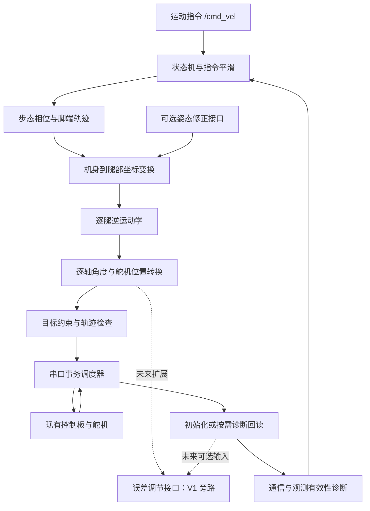

# v1 软件架构：运动学步态与误差调节扩展接口

2026-11-03 本地进度补充：用户已实现 tripod_phase 交替三脚相位采样，助手补充正式用例与 CMake 测试登记，Windows 严格构建及完整 CTest 12/12 通过。相位层只输出计划阶段和阶段进度，不含脚点、机身运动、跨边界事件或真实触地判断；下一步为规划机身位姿和脚点坐标变换。本轮未连接或同步 Pi，Pi 仍为 2026-11-02 的 11/11 版本与证据，成功同步基线不变。下方双端概览保留 2026-11-02 当时状态。

日期：2026-10-17；双端进度更新：2026-11-02；接口策略更新：2026-10-29；目标范围更新：2026-10-27。状态：实施方案与实现进度；已完成 [基础类型、配置模型、关节转换、局部/机身 FK/IK、单腿候选选择及可选平均速度检查、六腿整体求解、单腿关节线性插值、路径采样、限位/平面距离离散检查、六腿段组合规划、脚端摆动目标曲线和纯离线 CSV 预览](../src/hexapod_core/README.md)。Windows 与 Pi aarch64 构建及 CTest 均 11/11 通过，Pi 安装后的 ROS 预览入口已验证，两端 CSV 数值一致。最新同步基线为 2026-11-02；完整步态、运行通信模块和实机验证仍待推进，本轮未启动舵机动作。

## 1. 目标与范围

使用现有树莓派 4B、幻尔总线舵机控制板和 18 只 LX-225，通过 ROS 2 Jazzy / C++17 实现：

- 由运动学生成站立和步态目标，支持前后移动、横移、原地转向、平滑启停与指定完整周期数行走。
- 仅预留关节误差调节接口；V1 不实现读取角度后的闭环纠偏。原到位标定、补偿算法与补偿配置的实现后移，不作为步态开发前置阶段。
- 无 IMU 时独立运行；预留 IMU 数据与姿态修正接口。

本版不实现地形适应、脚端受力/形变补偿、自动纠正走偏、定位导航、动力学控制或在线自适应学习。基础几何、关节转换和安装限位仍是运动学执行的必要输入，不属于新增的物理误差补偿工程。

“实际角度”默认指舵机位置回读经逐轴转换后的角度，必须在报告中写明观测来源。若回读正确而机械角度不正确，需要外部角度测量，回读闭环无法自行发现。外部误差标定与调节实现留待设备改善后，不作为 V1 验收目标。

2026-10-27，用户说明当前控制板每秒只能下发十多帧控制目标，决定将角度回读闭环调节推迟到设备改善后。这里记录的是用户描述的当前设备条件，不是本轮新做的帧率测试，不据此填写精确控制频率或关节速度限制。位置读取与角度解码仍用于初始化、按需诊断和未来扩展；本次调整针对上位机反馈外环，不修改舵机内部控制。

## 2. 硬件约束与参数来源

- 物理事实继续以 [physical-baseline.md](physical-baseline.md) 和 [robot_hardware.json](../config/robot_hardware.json) 为准。本方案不修改或补造物理参数。
- 保留既有 ID：右前 1–3、右中 4–6、右后 7–9、左前 10–12、左中 13–15、左后 16–18。
- 2026-10-18 用户确认 500 为水平伸直数学零位，18 轴关节参考角均为 0；方向按 CAD 输出端与选定数学正轴推导，安装限位采用用户已写入并确认可达的 140～860（数学角 ±86.4°）。
- 固定机身安装变换、第一段 L2、第二段 2×L1+d、第三段 L3 分开建模。CAD 值按用户授权用于理想模型并保留来源；2026-10-20 起不计胶垫，理想触点取金属端，为第三轴局部 (0,−112.53,0) mm，其模长等于金属端 L3。
- 未知关键参数保留 null。预览可使用显式候选模型；实机动作需要对应关节和动作范围的有效参数。启用某动作前验证其整个轨迹，不要求为了单腿测试先完成所有全身标定。
- 当前控制板原厂 UART 固定为 9600、8N1。官方 FAQ 第 8 项明确说明不可修改；不能通过更改树莓派波特率提速。[官方 FAQ](https://forum.hiwonder.com.cn/t/topic/440)
- 控制板协议与直连舵机协议不同。未来升级通信只替换硬件后端，不把当前协议包按新速率直接复用。[控制板协议](https://docs.hiwonder.com/projects/Bus-Servo-Controller/en/latest/docs/2.Bus_Servo_Controller_Secondary_Development.html)
- 新 v1 电压策略依据现有 LX-225 规格书 6–8.4V；旧 demo 的 8.7V 临时例外只属于原 demo，不自动继承。电压采样的精度仍未标定。

## 3. 运行结构

采用一个主要 ROS 节点、一个纯算法库和一个串口工作线程。主节点内用类划分职责，避免将每一层拆成独立节点。



主循环不等待串口回包。所有串口操作由一个工作线程串行执行，使用期限明确的事务；不允许标定程序、ROS 回调和诊断工具同时操作同一设备。

## 4. 包与模块

下面是模块规划；工作区在 Windows 为 hexapod_ws，在树莓派为 /home/hexapod/hexapod_ws。hexapod_core 已创建，其余新包待实现。

```text
ros2_ws/src/
  hexapod_core/                  # 不依赖 ROS 或串口的 C++ 库
    model                       # 几何、逐轴映射、参数来源与有效性
    kinematics                  # FK / IK、解支连续性、可达性
    gait                        # 相位、支撑/摆动、轨迹与启停
    joint_compensation          # 仅预留接口，V1 不实现调节算法
    constraints                 # 安装限位、段间连续性与已确认的运动限制
    types                       # 指令、轨迹段、反馈与状态
  hexapod_hardware/              # 协议、传输、事务调度与假设备后端
  hexapod_control/               # 主节点、状态机、ROS 接口
  hexapod_bringup/               # 启动文件与运行/步态配置
  hexapod_demo/                  # 保留现有固定帧参考与协议测试
```

核心内部使用米、弧度、秒；现有硬件 JSON 的毫米/度在加载边界显式转换。舵机位置单位只在映射、补偿和硬件边界使用。腿索引、关节索引与物理 ID 采用明确映射，不依赖容器遍历顺序。

自定义代码统一使用下划线命名。主要类为 robot_model、leg_kinematics、gait_planner、joint_mapper、constraint_checker、bus_scheduler、motion_state_machine；类接口和实现分别放在对应的 .hpp 和 .cpp 中。joint_compensator 仅为预留接口规划，arrival_monitor 与 calibration_session 的具体实现后移。避免先引入通用插件框架或强制接入 ros2_control。

## 5. 运动学与步态

1. 运动输入为机身坐标系 vx、vy、wz；先限速、限制加减速，再生成轨迹。
2. 各腿站立脚点为配置参数，满足用户期望的屈膝站姿；不直接将 demo 的位置表作为已标定站姿。
3. 支撑期在规划地面坐标系中保持落脚点，依据规划机身运动换算到各腿坐标；转向时计入各腿的位置差异。该坐标系是平地、不打滑假设下的规划参考，不是实测世界位姿。
4. 摆动期生成平滑抬脚、前摆和落脚轨迹。连续轨迹按可实现的下发时刻采样，逐段检查实际关节插值对应的脚端路径和离地余量。
5. 单腿慢速摆动用于首轮联调；v1 正式目标为可调周期、步幅、抬脚高度和支撑占空比的交替三脚步态。
6. A 组为右前、左中、右后；B 组为左前、右中、左后。一个完整周期包含两组各摆动落地一次。
7. 轨迹层遇到不可达、未确定自由角、接近奇异、IK 解跳变或超出关节约束时按约束策略拒绝并重新规划；通过缩小整条轨迹的速度/步幅重新规划，不独立裁切六腿角度后继续行走。该轨迹策略待实现，几何候选枚举本身不会自动拒绝所有膝奇异附近的离散解。
8. 初期采用慢速、较长支撑期和转换重叠；在平地和已确认站姿下验证支撑切换。质量/重心未知时不宣称已经验证静态稳定裕量。

正常停止先减速，再按相位落脚、收步回站姿。所谓落脚完成在无触地传感器时仅是计划事件，不能当成真实触地观测。

2026-10-25 已实现 inverse_candidates_in_leg_frame()：在腿根局部坐标中枚举正负径向与正负膝角，最多四套离散几何候选，经 FK 残差校验和周期角去重。伸直或反折候选可返回 success，并以 knee_near_singular 标记；可达偏航轴上的自由 yaw、等长两段完全折叠时的自由 q2 返回 singular 且候选为空；几何不可达返回 unreachable，NaN/Inf 输入报错。当前未包含舵机安装限位筛选、连续候选选择、机身 IK 包装接口或步态；success 仅表示获得几何候选。

## 6. 关节误差调节：仅预留接口

### 6.1 数据边界与 V1 旁路

保留现有 joint_targets 和 joint_observation，分别表达：

- q_des：运动学理想目标角。
- p_nom：按逐轴标定映射、限位检查和整数取整得到的名义位置。
- p_cmd：准备下发的位置；V1 不应用误差补偿，对已接受的目标使用 p_cmd = p_nom。
- p_read / q_read：实际取得的本次回读及解码角度；缺失时保持无值。
- 计划/发包时间、预计执行区间、回读请求/完成区间和有效性。

旁路表示没有应用调节算法，不表示误差已经标定为零；不生成假的反馈或到位状态。整数位置解码出的名义关节角与实测角度保持区分。

### 6.2 扩展接口契约

预留 joint_compensator 的接口位置，结合后续执行层确定具体 C++ 声明；当前尚未新增算法或接口源码。未来接口应遵守：

- 接收原始目标和名义命令；若使用观测，显式接收其有效性、来源和请求/接收时间区间。
- 输出与原始目标分开的命令结果，区分旁路、缺少有效观测与实际应用调节；V1 只走显式旁路路径。
- 不在算法接口内访问串口、睡眠等待或循环补读，通信归统一调度器。
- 未来调节后的命令重新通过安装限位、整数位置和段间约束检查，不夹紧目标来伪装有效。

原方案的固定补偿表属于前馈，回读后再次调整命令属于反馈外环；两者概念不同，本次将相关具体实现均后移。设备改善后再设计标定流程、控制律、采样/动作时序、调节上限及精度验收。V1 不新增补偿表或未验证增益。

### 6.3 初始参考与连续选择

- 第一帧参考来自有效反馈或用户明确确认的初始姿态，不能默认全零。
- 后续可使用上一帧已接受命令对应的名义角作为规划参考，不称为当前实测角度。中断、掉电或手动搬动关节等导致参考失效后，重新建立有效参考。
- 保留位置读取与角度解码，供初始化和按需诊断；不要求每个目标后全量回读再纠偏。
- 计划动作时间结束只表示预计完成，不证明实测到位。0.24°/位置单位是原生换算步长，不是实物精度保证。

## 7. 9600 链路的时间安排

按官方协议与 8N1 计算下列纯线缆时间，不包含板内处理、舵机查询、超时、补读和操作系统延迟：

| 操作 | 字节数 | 理想时间 |
| --- | ---: | ---: |
| 18 舵机目标下发 | 61 | 63.54 ms |
| 全量位置查询请求 | 23 | 23.96 ms |
| 全量位置回包 | 59 | 61.46 ms |
| 电压查询请求加回包 | 4+6 | 10.42 ms |

只下发时的理想上限约 15.7 帧/秒；每帧后顺序查询并收齐全量位置时约 6.7 帧/秒。这不是控制板内部动作刷新率，也不是能完成的机械动作次数。

初始调试预算：

| 工作 | 目标频率 | 说明 |
| --- | ---: | --- |
| 本地规划/状态更新 | 50 Hz | 便于响应指令，无硬实时承诺，不等于串口帧率 |
| 全身目标下发 | 5 Hz | 作为初始目标，需板内延迟与插值行为实测通过 |
| 全量位置回读 | 按需；启用周期诊断时暂以 1 Hz 预算 | 初始化或诊断用途，不参与每帧纠偏；待实测 |
| 电压回读 | 0.5 Hz | 统一安排事务 |

启用 1 Hz 位置诊断时，原初始预算按串行线缆时间保守相加约 408 ms/秒；按需查询时重新核算。这不是本次新增测试结果，剩余时间不是可直接耗尽的裕量；尤其需考虑一次全量查询造成的连续占用。

调度规则：

- 运动目标携带到期时间、有效截止时间和动作持续时间；查询只在预估能满足下一动作期限的窗口启动。
- 不向控制板假设性发送未来时间戳：控制板收到完整包后何时执行需实测。以物理发送完成为基础估计执行起点，保留不确定性；write 返回不等于已执行，命令无确认时也不能标记为已到位。
- 未发送的同一相位内部目标最多保留一个最新候选；起落脚和支撑组切换是必须执行的相位边界，不能被“最新目标”覆盖跳过。检查有效期与从上一段命令到候选的连续性，不让过期轨迹积压。若不能连续衔接则拒绝并进入停止/故障处理。
- 查询、补读均有共同期限；不得用反复补读无限阻塞动作。不能满足时序时先降低配置频率/步速，持续逾期进入故障，不靠高速补发追赶。
- 运动/收步优先；启用诊断时约定查询期限与观测最大年龄，过期标为无效，不反复补读阻塞动作。V1 不以每个摆动阶段取得新回读为常规推进条件；明确依赖观测的模式仍须执行对应的失效停止策略。
- 首次运动前建立有效初始参考；重新连接或参考失效后不直接沿用旧规划状态。未来标定流程再单独设计事务序列。
- 保存发包和往返耗时分布，检查 95/99 百分位和最坏超时，依据实测决定频率。

板内未承诺的行为必须先核对：动作途中新目标如何替换旧目标、插值方式、全量回读延迟、缺失舵机时的等待方式。若 5 Hz 轨迹不能顺畅执行，先降低步速/调整段时长；不将提高本地计算频率当作链路提速。

## 8. 核心接口与状态

建议的数据契约：

| 类型 | 必需内容 |
| --- | --- |
| motion_request | vx/vy/wz、指令时间、超时、可选完整周期数 |
| foot_targets | 六腿脚点、坐标系、规划时刻、支撑/摆动相位 |
| joint_targets | 18 个 q_des、名义映射、轨迹段标识；基础容器已实现 |
| servo_frame | 物理 ID、18 个 p_cmd、持续时间、下发期限、配置版本 |
| joint_observation | 原始回读、有效性、请求/接收时间、数据年龄、来源；基础容器已实现 |
| body_attitude | 可选姿态、坐标系、时间、有效性、来源 |

回包不带精确采样时间，全量回读也不保证 18 轴同时采样。保存请求到回包完成的时间区间；不能将接收时刻伪装为精确测量时刻。对外若用接收时间作为消息时间戳，必须注明该近似。缺失反馈保留无效标记，不用 0 或历史值冒充本次观测。

主要 ROS 接口：/cmd_vel 输入，/joint_states 发布有效回读，/diagnostics 发布通信状态、观测有效性与串口耗时；站立、停止和指定周期行走使用互斥的服务/动作入口，具体服务类型在实现时按交互需求确定。没有完整新回读时，不发布一帧伪造的完整 joint_states，不用命令角冒充实测角；标定与闭环误差调节入口留待未来。

运行状态：DISCONNECTED → CHECKING → READY → STANDING_UP → STANDING → WALKING → STOPPING → STANDING；CALIBRATING 留待未来标定功能实现。连接成功不自动起立，恢复通信不自动续走。

任意运行状态可进入 FAULT。正常零速度/指令超时触发收步；通信断开或位置未知时不强制回站姿，也不默认卸力。若可获得新鲜位置且链路可用，可尝试以当前位置替换目标；它有通信延迟且可能失败，不是硬急停。控制板停止动作组指令不作为即时位置指令的急停。

## 9. IMU 扩展接口

预留 body_attitude_provider 和 body_pose_correction 两个接口。v1 使用显式关闭的实现，姿态观测无效，修正模块显式旁路；不得发布假的水平姿态或全零四元数。

未来 /imu/data 使用 sensor_msgs/msg/Imu，经安装坐标转换和状态估计后输出 body_attitude，再在 IK 前修正机身变换。数据过期时的关闭/停止策略单独配置；IMU 不改写关节到位补偿表，也不用于证明脚端真实触地。消息不可用字段按 [ROS 官方定义](https://github.com/ros2/common_interfaces/blob/jazzy/sensor_msgs/msg/Imu.msg) 标记。

## 10. 配置归属与复用

- config/robot_hardware.json：物理信息唯一来源；若更新实物参数，同步基准文档。
- config/joint_compensation.json 留待未来补偿功能实现；V1 不新增补偿表，不把旁路解释为已测得零误差。
- hexapod_bringup/config/gait.yaml：步态和候选站姿；注明开发参数，不伪装成实测值。
- hexapod_bringup/config/runtime.yaml：串口、频率、期限、通信新鲜度与执行模式。安装限位来自硬件配置，不再复制一份。
- 默认预览不打开串口；probe 模式只读；execute 模式才允许运动。标定动作同样需要显式执行模式。
- 从现有 demo 提取包编码、串口锁、解析、缺失 ID 定向补读及虚拟串口测试。按新调度器改造阻塞查询，不照搬每帧等待动作结束再全量回读的主流程。
- 保留 demo 原目录和历史候选姿态，不把其电压例外、角度假设和误差容差带入新控制器默认配置。

## 11. 实施顺序与验收

| 阶段 | 交付 | 验证重点 |
| --- | --- | --- |
| A | 配置加载、逐轴映射、FK/IK、离线预览 | ID/单位一致，关节参考角不混淆，FK/IK 一致，可达性、解连续性、未知项拒绝 |
| B | 串口后端、调度器、只读诊断 | 虚拟设备注入丢包/迟包/缺 ID/断线；实机只读测耗时，不自动发动作 |
| C | 误差调节接口契约与显式旁路 | 目标/命令/观测分离，不依赖每帧回读与纠偏，不生成虚假反馈 |
| D | 单腿轨迹、六腿站立、慢速三脚步态 | 关节插值下的脚端路径、支撑切换、连续性和启停，随后验证前后/横移/转向 |
| E | 集成与参数固化 | 完整周期计数、指令超时、有限次收步、通信故障和重连不续走 |

V1 不以闭环误差收敛或补偿前后精度改善作为验收条件。验收记录包含目标、名义整数位置、命令、计划/发送时间和配置版本，以及实际取得的诊断回读、时间区间和缺失/重试；没有回读时保持未知。未来实现调节后再根据独立采样确定精度指标。行走验收记录的是实机完成情况；离线测试通过不等于已验证实机行走。

当前已实现基础类型、只读配置模型、关节名义角度转换、单腿 FK、坐标双向变换、局部/机身 IK 候选、单腿候选映射过滤/策略选择及可选平均速度检查，以及 body_ik_solver 六腿合成。2026-10-28 的旧选择器 Windows CTest 3/3 通过；2026-10-29 速度接口完成语法核对；2026-10-30 新增速度和六腿正式用例后 Windows CTest 5/5 通过。整段轨迹、步态、运行控制器与通信调度仍待推进；关节误差调节仅预留接口，具体实现后移。

2026-10-29 接口策略：外层 optional<leg_connection_request> 表示本次是否要求检查，提供请求后必须包含完整的时长和三轴有限正速度预算。速度由上层规划配置提供，不当作实测设备能力；不再保留请求内部逐轴可选速度和“速度未知”状态。约束在候选评分前逐套检查，结果采用 average_speed_limit_exceeded / no_candidate_within_speed_limits，区别于其他策略拒绝。结果对象显式构造，未要求检查时选解结果中的 connection 为空。当前默认奇异/分支策略仍为 reject / keep_reference_branch，具体动作需要明确选择；端点策略通过不等于整段路径已经验证。设计演变与理由见 [开发历史](core-deployment-validation.md)。

2026-10-30 六腿求解边界：六腿全部成功才返回完整 solution；失败保留首个失败腿与单腿原因，不返回部分解。输入参考和历史分支不被修改，新参考取整数位置解码后的名义角。求解器填写理想角与名义位置，commanded_positions 保持无值，执行层旁路待实现；本次成功不代表整段轨迹或实际动作已验证。

2026-10-31 插值进度：已实现 interpolate_leg_joint_angles() 并完成正式回归。局部 FK 反例验证关节插值中点脚端可低于两个端点，因此下一步仍需路径采样与约束检查。该线性模型没有被标记为控制板实测插值，有限离散采样也不构成完整连续路径保证；机身坐标原点不等于地面，不将脚点 Z=0 当作默认接触平面。

2026-10-31 后续路径采样进度：leg_path_sampler 已实现并通过正式回归，Windows CTest 从插值阶段 6/6 增为 7/7。采样以统一比例记录连续插值角与机身坐标脚点；内部点不重新量化，采样密度不等于串口发送频率。路径检查器仍待实现，后续约束须明确参考平面和坐标，不能把采样器输出或离散检查通过表述为实机执行许可或整段连续安全证明。

2026-11-01 路径约束进度：leg_path_checker 已实现并通过 Windows CTest 8/8 正式回归；在固定机身参考/固定平面/线性插值模型中按序检查安装限位和显式离面距离，保留首个失败采样及原因。非法约束、模型缺参和数值失效抛异常。仅端点采样可遗漏中途下探的用例已保留，连续段保证、机身运动变换和完整步态仍待实现；当前尚未将该检查接到六腿段整体规划中。

2026-11-01 后续组合进度：body_segment_planner 已接通六腿选解与逐腿名义角路径检查，正式回归增为 Windows CTest 9/9。完整目标只在全部检查通过后提供，输入参考和分支不推进，选择失败与路径失败分别保留。共享约束校验已开放复用，全部最小距离先检查；路径失败不自动换解或证明所有候选不可行。脚端摆动曲线、按相位配置约束、机身运动变换、运行调度与实机验证继续推进。

2026-11-02 摆动曲线进度：sample_swing_trajectory() 已实现并通过正式数学回归；同一测试还连接 20 段右中腿摆动与六腿段规划器，其他 15 轴目标保持不变，Windows CTest 增为 10/10。测试参考系明确选为固定机身系，候选初始姿态、速度预算、时间和参考平面均为显式离线输入；未发布真实反馈或执行命令。可运行的离线序列预览入口尚待实现，完整步态仍需相位、支撑期、机身运动变换和运行调度。

2026-11-02 双端部署进度：用户明确要求检查程序后同步，已补全预览 CMake、安装入口和 CLI 正式测试，Windows/Pi 均 CTest 11/11，Pi 安装入口输出的 20×25 CSV 与 Windows 数值一致。最新成功同步基线更新为 2026-11-02；较早各日期的待同步记录保留其历史语境。当前理想触点仍为金属端 (0,−112.53,0) mm，用户已明确实物未安装胶垫；硬件 JSON SHA-256 保持 3d5190cbfc611f65425bb0e21dedb118ef1eeffb60d337cce439291ac31e2a46，物理参数未改。构建、同步和离线预览不代替实机动作验证，本轮未驱动舵机。
