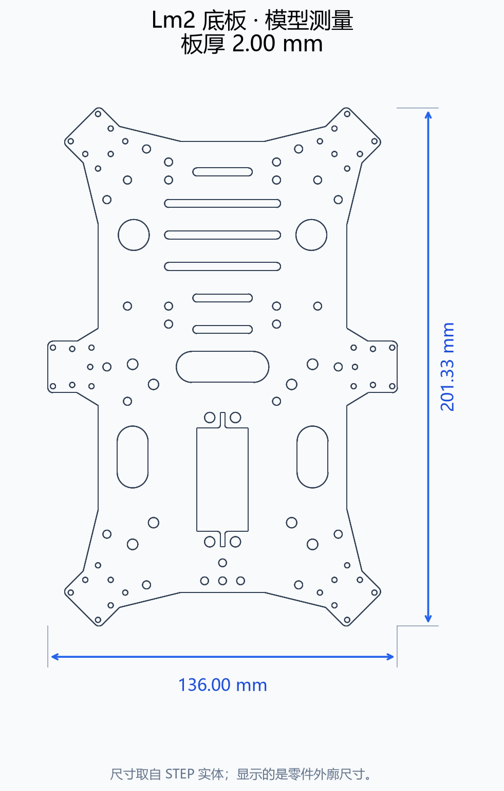
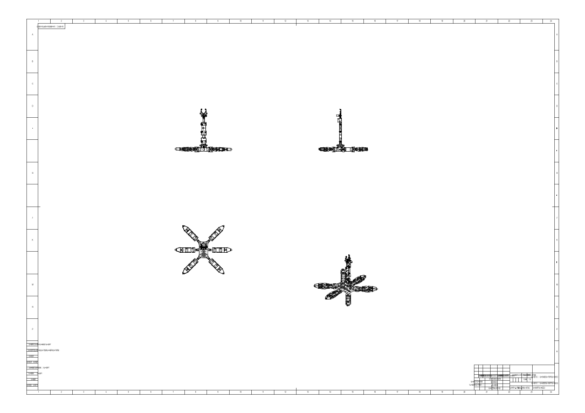

# Lm2 框架尺寸初步测量

测量日期：2026-10-14。以下数值来自商家提供的 STEP 实体模型，单位为 **mm**，显示到小数点后两位。

## 主要零件

| 模型零件名称 | 外廓尺寸 | 说明 |
| --- | --- | --- |
| Lm2上下板 / Lm2六足底板 | 201.33 × 136.00 × 2.00 | 平面长 × 宽 × 板厚；独立底板 STEP 与完整装配体中零件尺寸一致 |
| 腿部支架 | 121.58 × 40.00 × 2.00 | 平面外廓 × 板厚，不等于两个关节轴心之间的距离 |
| 十字大u支架 | 62.00 × 56.00 × 56.00 | 零件坐标轴方向的外廓尺寸 |
| 小u连接件 | 43.50 × 38.00 × 21.50 | 零件坐标轴方向的外廓尺寸 |
| 装饰件 | 52.00 × 30.00 × 6.00 | 零件坐标轴方向的外廓尺寸 |
| 总线双轴舵机 | 51.00 × 40.00 × 20.00 | 商家模型中的舵机外廓，未据此确认实物舵机型号 |
| 脚垫 | 14.00 × 14.00 × 9.00 | 模型外廓；非金属零件 |

## 当前装配姿态的整体外廓

模型坐标 **Y 为上下方向**，X、Z 为底盘平面方向。

| 装配对象 | X方向跨度 | Z方向跨度 | Y方向高度 |
| --- | --- | --- | --- |
| Lm2六足机器人（不含机械臂和云台） | 633.30 | 548.24 | 56.00 |
| Lm2六足机器人完整体（含机械臂和云台） | 633.30 | 548.24 | 479.11 |

六条腿在这个模型中为平展姿态，所以上述跨度和高度不能当作机器人站立时的尺寸、最大工作空间或腿长。零件外廓尺寸也不能直接代替运动学所需的关节轴心间距。

## 数据来源与方法

- 完整模型：`C:\baidunetdiskdownload\021 Lm2六足机器人图纸\021 Lm2六足机器人图纸\三维STEP通用格式\Lm2六足机器人完整体.STEP`
- 独立底板：`C:\baidunetdiskdownload\021 Lm2六足机器人图纸\021 Lm2六足机器人图纸\三维SolidWorks格式\Lm2六足支架\Lm2六足底板.STEP`
- 二维装配图：`C:\baidunetdiskdownload\021 Lm2六足机器人图纸\021 Lm2六足机器人图纸\二维CAD图纸\Lm2六足机器人完整体图纸.DXF`
- STEP 长度单位明确为毫米，DXF 的单位字段也为毫米。DXF 模型空间未发现 DIMENSION 标注实体，文字主要为图框内容，标题栏比例为 1:5；测量结果直接来自三维实体。
- 使用 Open CASCADE 的实体边界计算，包含 STEP 装配变换；按模型坐标轴计算外廓，而非从图像像素估算。
- `Lm2_model_measurements.json` 保存完整模型的零件定义及 310 个装配树节点的边界坐标，和独立底板的测量结果。

